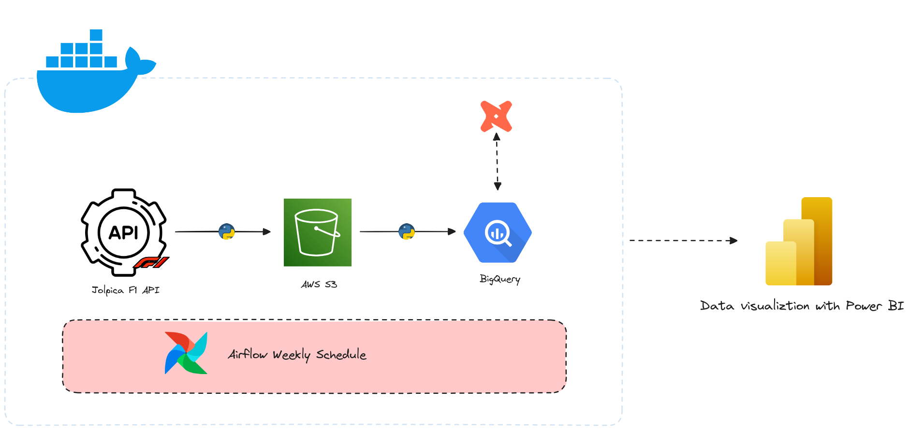

# 🏎️ F1 Data Analysis 📊

This project focuses on collecting, processing, and analyzing Formula 1 🏁 data. The goal is to structure the data effectively in a data warehouse to enable insightful analysis and visualization.

## 📂 Table of Contents

- [Project Overview](#project-overview)
- [Setup](#setup)
- [Features](#features)
- [Usage](#usage)
- [Project Workflow](#project-workflow)
- [License](#license)

## 📌 Project Overview

Formula 1 generates vast amounts of data, from race results to lap times. This project collects, processes, and loads this data into a structured data warehouse, making it easier to extract insights and build meaningful visualizations.

This project relies on data from the [Jolpica F1 API](https://github.com/jolpica/jolpica-f1).  
Big thanks to the contributors of the Jolpica F1 repository for making this data accessible! 🚀  

For more details, check out their repo: [jolpica/jolpica-f1](https://github.com/jolpica/jolpica-f1).

## Setup
### 1. Environment Variables

Copy `.env-example` to `.env` and fill in your values:

```bash
cp config/.env-example config/.env
```

```ini
# AWS — S3 landing zone
AWS_ACCESS_KEY=your_aws_access_key
AWS_SECRET_KEY=your_aws_secret_key
s3_bucket=your_bucket_name
aws_region=eu-west-3

# Google BigQuery
BQ_PROJECT=your_gcp_project_id
BQ_DATASET=your_dataset_name

# GCP Service Account (see below)
SERVICE_ACCOUNT_JSON_PATH=/home/<your-user>/.gcp/f1-dataanalysis-sa.json
```

### 2. GCP Service Account Key

Download your GCP service account JSON key from the Google Cloud Console and place it **outside the project directory** to avoid accidental commits:

```bash
mkdir -p ~/.gcp
mv ~/Downloads/your-service-account.json ~/.gcp/f1-dataanalysis-sa.json
```

Then set `SERVICE_ACCOUNT_JSON_PATH` in your `.env` to the absolute path of that file.

> The `config/` directory is gitignored for `*.json` files, but keeping secrets outside the repo is the safer convention.

### 2. Development Environment
This project comes with a **devcontainer**, making the setup process seamless. By using the provided development container, all necessary dependencies will be pre-installed.

### 3. App Image

You can build and run the application using a Docker image. Follow these steps:

1. **Build the Docker Image**:
   First, you can build the Docker image. In the terminal, run the following command from the root directory of the project:
   ```bash
   docker build -t your-image-name .
   ```

2. **Modify Airflow Admin Access & Route Port**:
   - The application’s configuration, including the Airflow admin access and the exposed route port, can be customized in the `entrypoint.sh` script. Modify these values as needed for your setup.
     - **Airflow Admin Access**: Set the admin credentials for the Airflow UI.
     - **Route Port**: Adjust the port on which the application will be accessible.

3. **Build and Run the Container with the `run.sh` Script**:
   If you prefer to automate the process of building and running the Docker container, you can use the `run.sh` script. The script will handle the permissions and execution of the container with the correct environment variables.

   - First, ensure the script has execution permissions:
     ```bash
     sudo chmod +x run.sh
     ```

   - Then, execute the script to build and run the Docker container:
     ```bash
     ./run.sh
     ```

   The `run.sh` script will:
   - Build the Docker image (if it hasn't been built already).
   - Set up the necessary environment variables and mount the required volumes.
   - Start the container with the appropriate settings, including port exposure.


## 🚀 Features

- 📥 **Comprehensive Data Collection**: Retrieves F1 🏎️ data from the Jolpica API, including race results, sprint results, qualifications, championship standings, pit stop data, and lap times.
  
- 🛠️ **Optimized Data Preparation**: Cleans and structures raw data using Polars to ensure consistency and efficiency.

- 🏦 **Centralized Data Storage**: Loads structured data into Google BigQuery, providing a scalable and reliable data warehouse.

- 📊 **Advanced Data Transformation**: Uses dbt to refine and optimize data models, ensuring high-quality insights. The structured warehouse follows a layered approach (staging → intermediate → marts).

- 📈 **Flexible Data Utilization**: The processed data can be leveraged for dashboards in Power BI, in-depth analysis, or other business intelligence applications.

## ⚙️ Usage

Once the environment is set up, the project allows you to fetch, transform, and analyze Formula 1 data. More details on setup will be provided soon with the addition of a development container.

## 🔄 Project Workflow

<p align="center">

</p>

1. **📥 Data Collection**: Retrieve race data from the Jolpica API, including results, standings, pit stops, and lap times.

2. **🛠️ Data Preparation**: Clean and format raw data using Polars for consistency and accuracy.

3. **🏦 Data Storage**: Load structured data into Google BigQuery for scalable storage and efficient querying.

4. **📊 Data Transformation**: Use dbt to refine data models, following a structured approach (staging → intermediate → marts) to optimize insights.

5. **📈 Data Utilization**: Leverage the data for dashboards in Power BI, advanced analysis, or other business applications.

## 📜 License

This project is licensed under the MIT License. See the LICENSE file for details.
